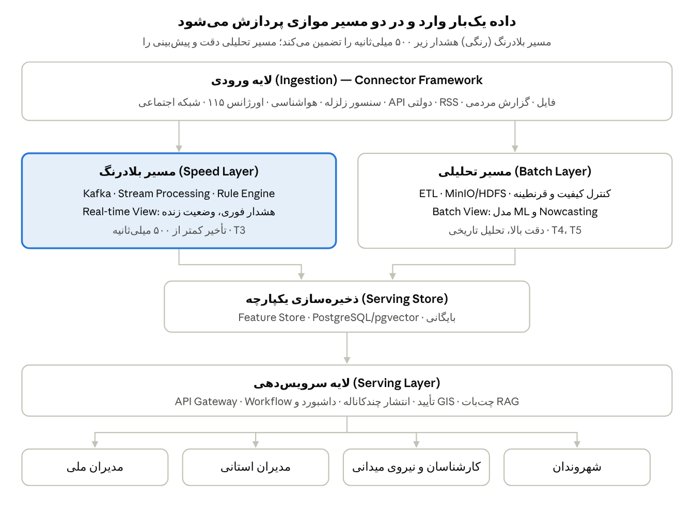
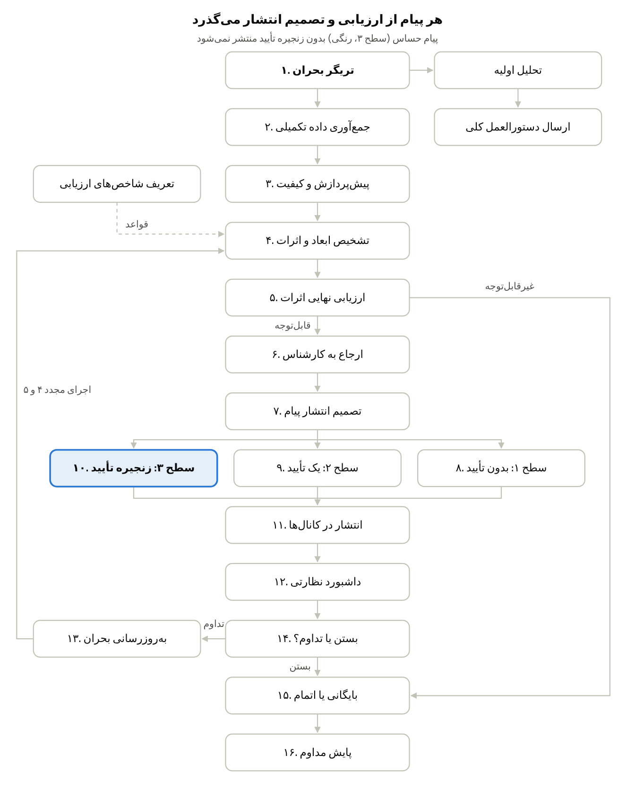

# SAS — معماری سامانه هوشمند اطلاع‌رسانی و پاسخگویی بحران (آگاه‌یار)

نسخه ۱.۰ · ۱۴ اکتبر ۲۰۲۶ · مبنا: جدول ۴ و ۵ پروپوزال آگاه‌یار

## ۱. مقدمه و محرک‌های معماری

سامانه بر معماری Lambda و میکروسرویس بنا می‌شود: مسیر بلادرنگ برای هشدار زیر ۵۰۰ میلی‌ثانیه و مسیر دسته‌ای برای تحلیل دقیق و پیش‌بینی. این سند معماری لازم برای تحقق نیازمندی‌های سند SRS (نودهای جدول ۴ و بسته‌های جدول ۵) را توصیف می‌کند.

### ۱-۱. دامنه

پایلوت زلزله در تهران، مرکزی و هرمزگان، در سه سطح ملی، استانی و محلی؛ تحویل MVP در ماه ۴ و پایلوت عملیاتی در ماه ۸. معماری باید بدون بازنویسی به مقیاس ملی برسد.

### ۱-۲. محرک‌های کیفی

| محرک | هدف | پاسخ معماری |
| --- | --- | --- |
| سرعت واکنش | هشدار اولیه زیر ۵۰۰ms، اطلاع‌رسانی زیر ۵ دقیقه | Speed Layer با Kafka و Stream Processing |
| دقت تصمیم | تصمیم مبتنی بر داده پاک و قابل ردیابی | Batch Layer، امتیاز کیفیت، قرنطینه و Lineage |
| دسترس‌پذیری | ۹۹٫۹٪ حتی در اوج بحران | Active-Active/Hot Standby، DR، Retry و DLQ |
| کنترل انسانی | هیچ پیام حساسی بدون تأیید منتشر نشود | Workflow سه‌سطحی تأیید و Audit |
| حاکمیت داده | استقرار و نگهداری داخل کشور | مدل‌های زبانی محلی (مثل GPT-OSS)، مرکز داده داخلی |
| مقیاس‌پذیری | بیش از ۱۰۰۰ کاربر همزمان، گسترش به استان‌های دیگر | میکروسرویس بدون حالت با مقیاس افقی |
| تاب‌آوری سازمانی | ادامه کار با منابع فاقد API | Connector Framework و fallback (Mock API/CSV Proxy) |

یادداشت: نام کتابخانه‌ها و ابزارها مطابق پروپوزال است و ممکن است در پیاده‌سازی نهایی بازبینی شود.

## ۲. نمای کلی معماری

هر داده یک‌بار از لایه ورودی می‌گذرد و همزمان به هر دو مسیر می‌رسد؛ خروجی هر دو در یک ذخیره‌ساز مشترک یکی می‌شود. IAM، Audit و مانیتورینگ (T11، T12) همه لایه‌ها را پوشش می‌دهند و برای خوانایی رسم نشده‌اند.

## ۳. نمای مؤلفه‌ها

سامانه از ۱۴ سرویس مستقل تشکیل می‌شود که هر کدام به یک یا دو بسته کاری جدول ۵ تعلق دارد. ارتباط همزمان از طریق API Gateway (REST/OpenAPI) و ارتباط ناهمزمان از طریق Topicهای Kafka است.

| سرویس | مسئولیت | فناوری پیشنهادی | بسته | نودها |
| --- | --- | --- | --- | --- |
| Crisis Core | مدل دامنه، پرونده بحران، تریگر دستی | Backend + PostgreSQL | T1 | ۱، تحلیل اولیه |
| Connector Service | اتصال به API، RDBMS/NoSQL، فایل، RSS، شبکه اجتماعی؛ Source Registry، Retry، DLQ | Connector Framework، Kafka Connect | T2 | ۲، ۱۶ |
| Stream Processor | Window، Deduplication، Checkpoint، هشدار اولیه، هم‌بستگی منابع | Apache Kafka + Stream Processing | T3 | ۱، ۳، ۴، ۱۳ |
| ETL & Quality | پاک‌سازی، اعتبارسنجی Schema، امتیاز کیفیت، قرنطینه، Lineage | ETL گرافیکی تحت وب (موجود) | T4 | ۳ |
| Rule Engine | قواعد شدت، اثرات، فوریت، نسخه‌بندی و تست قواعد | Rule Engine | T5 | شاخص ارزیابی، ۴، ۵، ۷ |
| ML / Nowcasting | امتیاز ریسک، اثرات ثانویه، پیش‌بینی کوتاه‌مدت | Feature Store، سرویس‌دهی مدل | T5 | ۴، ۵ |
| NLP & RAG | NER، Intent، Slot Filling، جستجوی معنایی، پیش‌نویس پیام، Guardrail | Hazm، ParsBERT، pgvector/FAISS، LangChain، LLM محلی | T6 | دستورالعمل، ۶ |
| Chatbot Gateway | چت‌بات شهروندی وب و پیام‌رسان، ارجاع اضطراری | NLP & RAG + آداپتور کانال | T6، T8 | ۶، ۱۱ |
| Workflow Engine | صف کار، مسیر تأیید سطح ۱/۲/۳، SLA، Escalation | BPM/Workflow | T7 | ۶ تا ۱۰، ۱۴ |
| Dispatcher | صف انتشار، Rate Limit، Retry، رسید تحویل | Queue + آداپتورهای SMS/Push/IVR/Email/پیام‌رسان | T8 | ۱۱ |
| GIS & Dashboard | نقشه رویداد، KPI، Drill-down، گزارش PDF/Excel | Frontend + اتصال GIS کارفرما | T9 | تحلیل اولیه، ۱۲ |
| Citizen Portal & App | وضعیت لحظه‌ای، گزارش مردمی با عکس/موقعیت، تیکت | Web + Mobile | T9 | ۲ (منبع داده) |
| Lifecycle Service | State Machine بحران، به‌روزرسانی، بستن، بایگانی، Lesson Learned | Backend | T10 | ۱۳، ۱۴، ۱۵ |
| IAM & Audit | احراز هویت، RBAC، محدوده جغرافیایی، ثبت Audit Trail | Keycloak (ریلم‌های crisis-ops و crisis-citizen) + افزونه crisis-audit-spi | T11 | همه |

مانیتورینگ، CI/CD، Backup و محیط‌های تست (T12) سرویس جداگانه نیستند و در بخش ۸ آمده‌اند.

## ۴. نمای فرآیند: چرخه بحران

بحران غیرقابل‌توجه مستقیم بایگانی می‌شود؛ بحران در جریان با داده جدید به نود ۴ بازمی‌گردد. پایش مداوم (نود ۱۶) در صورت بروز نشانه جدید، دوباره تریگر را فعال می‌کند.

| نود | سرویس اجراکننده | رویداد خروجی (Kafka Topic) |
| --- | --- | --- |
| ۱، تحلیل اولیه | Crisis Core، Stream Processor | crisis.triggered |
| ۲، ۳ | Connector Service، ETL & Quality | data.ingested، data.curated، data.quarantined |
| ۴، ۵، تعریف شاخص | Rule Engine، ML / Nowcasting | crisis.assessed |
| ۶ تا ۱۰ | Workflow Engine، NLP & RAG | message.drafted، message.approved |
| ۱۱ | Dispatcher، Chatbot Gateway | message.delivered |
| ۱۲ | GIS & Dashboard | — (مصرف‌کننده همه رویدادها) |
| ۱۳ تا ۱۵ | Lifecycle Service | crisis.updated، crisis.closed |
| ۱۶ | Connector Service + مانیتورینگ | source.health |

نام Topicها پیشنهادی است و در طراحی تفصیلی T3 نهایی می‌شود.

## ۵. نمای داده

هیچ داده‌ای بدون ثبت منبع، زمان دریافت و نتیجه اعتبارسنجی وارد تصمیم‌سازی نمی‌شود. کنترل کیفیت در سه مرحله ورود، پردازش و سرویس‌دهی انجام می‌شود.

### ۵-۱. لایه‌های ذخیره‌سازی

| لایه | محتوا | فناوری |
| --- | --- | --- |
| Raw | داده خام همان‌طور که دریافت شده، برای بازپخش | Data Lake (MinIO/HDFS) |
| Curated | داده پاک، نرمال و غنی‌شده | PostgreSQL + Data Lake |
| Quarantine | داده زیر حداقل کیفیت، در انتظار بررسی اپراتور | Data Lake + جدول وضعیت |
| DLQ | پیام‌های ناموفق در دریافت یا پردازش | Kafka Topic جداگانه |
| Feature Store | ویژگی‌های تاریخی بحران برای مدل ML | Feature Store |
| Vector Store | بردار اسناد، دستورالعمل‌ها و داده شبکه اجتماعی | pgvector / FAISS |
| Serving Store | نمای یکپارچه Real-time View و Batch View برای داشبورد و API | PostgreSQL/pgvector |
| Archive | پرونده‌های بسته‌شده با سیاست نگهداری و RBAC | Object Storage |

### ۵-۲. امتیاز کیفیت و قرنطینه

- شاخص‌ها: کامل‌بودن، انطباق Schema، تازگی، عدم تکرار، سازگاری بین منابع، اعتبار مختصات و زمان، ردیابی‌پذیری و سطح اعتماد منبع.
- قواعد قطعی در Stream Processor و قواعد آماری/ML در Batch Layer اجرا می‌شوند.
- داشبورد کیفیت: وضعیت اتصال منابع، نرخ خطا، داده ناقص، تعداد قرنطینه و تاریخچه اصلاحات.

### ۵-۳. Lineage

هر رکورد شناسه منبع و زنجیره تبدیل‌ها را با خود حمل می‌کند. بنابراین هر عدد داشبورد یا پیام منتشرشده تا منبع خام قابل ردیابی است.

## ۶. معماری NLP و RAG

سرویس NLP & RAG فقط از اسناد تأییدشده پاسخ می‌دهد و خروجی آن پیشنهاد است، نه تصمیم. پاسخ به شهروند باید زیر ۳ ثانیه باشد.

### ۶-۱. پایپ‌لاین (جدول ۲ پروپوزال)

1. **پیش‌پردازش:** نرمال‌سازی، حذف اعراب و توکن‌سازی فارسی با Hazm؛ تشخیص زبان (فارسی، ترکی، عربی).
2. **درک پرسش:** Intent detection (≥ ۹۰٪)، NER (سازمان، تاریخ، نوع بحران، منطقه) و Slot filling با spaCy Pipeline و مدل Fine-tuned.
3. **Embedding:** تبدیل متن به بردار با ParsBERT یا mBERT.
4. **بازیابی:** جستجوی معنایی در pgvector/FAISS با فیلتر Metadata (F1 ≥ ۰٫۸۵).
5. **تولید:** LLM محلی (مثل GPT-OSS) با LangChain و Prompt Engineering؛ پاسخ با منبع قابل مشاهده.
6. **Guardrail:** بررسی با Rule Engine، حداقل Confidence و تشخیص درخواست اضطراری؛ در صورت شک، ارجاع به اپراتور.

### ۶-۲. موارد امتناع از پاسخ قطعی

ورودی متناقض، نبود منبع معتبر، داده منقضی، موضوع خارج از حوزه، Confidence پایین یا پیام با آثار امنیتی و اجتماعی گسترده. در این موارد وضعیت «نیازمند بررسی»، «اطلاعات ناکافی» یا «ارجاع به اپراتور» نمایش داده می‌شود.

### ۶-۳. کنترل ریسک مدل (MLOps)

- ثبت نسخه مدل، داده آموزشی و تمام ورودی‌ها و خروجی‌ها.
- پایش خطا، Model Drift و Data Drift؛ غیرفعال‌سازی و بازگشت به نسخه پایدار قبلی.
- ارزیابی با شاخص‌های جدول ۱۰ (صحت، Groundedness، پوشش استناد، نرخ توهم، صحت ارجاع و امتناع) روی مجموعه آزمون مرجع؛ آزمون Red Team دوره‌ای.
- انتخاب مدل نهایی بر اساس دقت، زمان پاسخ، استقرار داخلی، مصرف منابع و پشتیبانی فارسی؛ نتایج آزمون ثبت و قابل ممیزی است.

## ۷. معماری امنیت

امنیت بر مدل Zero Trust است: هر درخواست، حتی بین سرویس‌های داخلی، احراز هویت و مجوز می‌خواهد. T11 در ۱۵ از ۱۹ نیازمندی کارکردی حضور دارد؛ بنابراین از ماه ۱ زیرساخت مشترک است.

| لایه | کنترل |
| --- | --- |
| هویت | Keycloak با OAuth2/OIDC و JWT، اعتبارسنجی در API Gateway و بک‌اند؛ امکان فدراسیون با سامانه هویت کارفرما |
| مجوز | RBAC سه‌سطحی (مدیر ارشد، مدیر میانی، کارشناس) با محدوده جغرافیایی (ملی/استان/شهر) |
| انتقال | TLS برای همه ارتباطات، از جمله بین سرویس‌ها |
| ذخیره | رمزنگاری at-rest در پایگاه داده، Data Lake و Archive |
| حریم خصوصی | کمینه‌سازی و ماسک داده شخصی شهروندان؛ نگهداری داخل کشور |
| حسابرسی | Keycloak مرجع واحد Audit: رویدادهای کاربر و ادمین به‌همراه اقدامات کسب‌وکاری (تأیید، ویرایش، انتشار، تغییر قاعده) از طریق افزونه crisis-audit-spi؛ زنجیره هش و ارسال به SIEM |
| پیام حساس | تگ امنیتی پیام مسیر Workflow را تعیین می‌کند؛ دکمه توقف اضطراری انتشار |
| آزمون | Pen-Test و رفع آسیب‌پذیری اولویت‌دار پیش از پایلوت |

## ۸. استقرار، DevOps و دسترس‌پذیری

همه مؤلفه‌ها به‌صورت کانتینر روی کلاستر در مرکز داده داخل کشور مستقر می‌شوند؛ مدل‌های زبانی روی گره‌های GPU اجرا می‌شوند.

### ۸-۱. محیط‌ها

| محیط | کاربرد | داده |
| --- | --- | --- |
| توسعه | توسعه و تست واحد | Mock API و فایل شبیه‌سازی‌شده |
| تست/دمو | آزمون یکپارچگی، کارایی، امنیت، نمایش MVP ماه ۴ | داده آزمایشی و بخشی از داده واقعی |
| تولید (پایلوت) | اجرای عملیاتی در سه استان | داده واقعی مصوب |

### ۸-۲. DevOps (T12)

- CI/CD با آزمون Unit، Integration، Performance، Security و UAT.
- Logging متمرکز، Metrics و Alerting؛ پایش سلامت منابع و سرویس‌ها (نود ۱۶).
- Backup دوره‌ای و Runbook عملیاتی برای بازیابی.

### ۸-۳. دسترس‌پذیری و تاب‌آوری

- Active-Active یا Hot Standby با سایت DR؛ هدف SLA ≥ ۹۹٫۹٪.
- سرویس‌های بدون حالت با مقیاس افقی؛ Kafka با Replication برای عدم از دست رفتن رویداد.
- قطع منبع: Retry، صف نگهداری، DLQ و بازیابی خودکار. قطع کانال: انتشار از کانال جایگزین.
- Chaos Engineering و تمرین Fail/Recover در ماه ۶ و Drill/Observe در ماه ۷ (گانت جدول ۷).

## ۹. تصمیمات معماری، مرحله‌بندی و ریسک‌ها

### ۹-۱. تصمیمات معماری (ADR)

| شناسه | تصمیم | دلیل |
| --- | --- | --- |
| ADR-01 | معماری Lambda (Speed + Batch) | در بحران سرعت و دقت همزمان لازم است |
| ADR-02 | میکروسرویس با Kafka به‌عنوان ستون رویداد | مقیاس افقی، جدایی استان‌ها و بازپخش رویداد |
| ADR-03 | Rule پیش از ML؛ مدل فقط پیشنهاددهنده | شفافیت و قابلیت توضیح در تصمیمات حاکمیتی |
| ADR-04 | RAG روی اسناد تأییدشده با LLM محلی | کاهش توهم و حاکمیت داده |
| ADR-05 | سه سطح تأیید پیام بر اساس تگ | تعادل سرعت پیام عادی و کنترل پیام حساس |
| ADR-06 | قرنطینه به‌جای حذف داده نامعتبر | هیچ سیگنالی از دست نمی‌رود |
| ADR-09 | Keycloak مرجع هویت و Audit (جزئیات در پلن توسعه، بخش ۱-۳) | یک منبع واحد برای حسابرسی و تطبیق با الزامات افتا |
| ADR-07 | استفاده از هسته موجود (ETL گرافیکی، GIS، چت‌بات RAG) | کاهش ریسک و زمان اجرا |

### ۹-۲. مرحله‌بندی معماری

| لایه | ماه ۴ (MVP) | ماه ۸ (پایلوت) |
| --- | --- | --- |
| ورودی | کانکتورهای پایه، ورود دستی | Stream، شبکه اجتماعی، Retry/DLQ |
| پردازش | بستر Stream، ETL پایه، Rule محدود | Speed Layer عملیاتی، قرنطینه، Rule+ML |
| هوش مصنوعی | RAG پایه، پیش‌نویس پیام | چت‌بات مستند، ارجاع اضطراری |
| گردش کار | Workflow پایه، تاریخچه | تأیید سطح ۱ و ۲، بایگانی |
| انتشار و نمایش | Web/API، SMS آزمایشی، نقشه پایه | کانال‌های پایلوت، داشبورد عملیات |
| امنیت و عملیات | احراز هویت، نقش‌ها، محیط تست | Audit، کنترل دسترسی، UAT |

### ۹-۳. ریسک‌ها

| ریسک | اثر | کاهش |
| --- | --- | --- |
| تأخیر دسترسی به منابع واقعی | پذیرش نهایی فقط با داده واقعی ممکن است | Mock API و CSV Proxy؛ توافق منابع در مرحله اول |
| توهم مدل زبانی | پیام نادرست در بحران | RAG، Guardrail، تأیید انسانی پیام حساس |
| اشباع در اوج بحران | از دسترس خارج شدن سامانه | مقیاس افقی، Rate Limit، تست استرس |
| خبر جعلی در شبکه اجتماعی | تشخیص بحران نادرست | امتیاز اعتبار منبع، هم‌بستگی چند منبع، بررسی انسانی |
| تفاوت فرآیندهای استانی | دشواری توسعه ملی | قواعد و قالب‌های قابل پیکربندی no-code برای هر استان |
